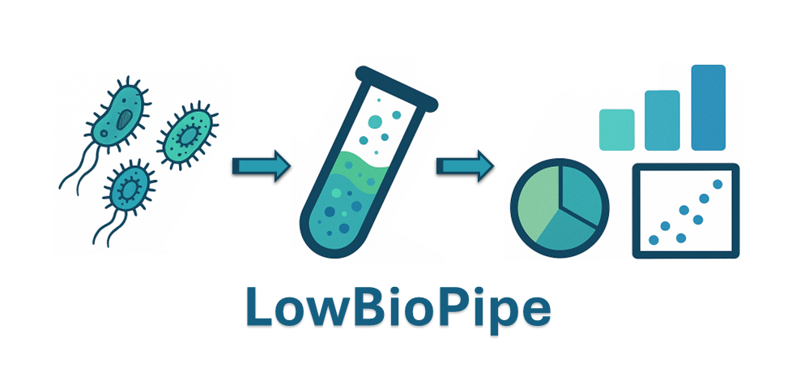

# LowBioPipe

<div align="center">



**A Nextflow wrapper for statistical analysis of low biomass microbiome data**

[](https://www.nextflow.io/)
[](https://github.com/Physics4MedicineLab/LowBioPipe/actions/workflows/ci.yml)
[](LICENSE)
[](CHANGELOG.md)

</div>

## Overview

LowBioPipe is a Nextflow-based computational framework that serves as a wrapper for processing outputs from the [nf-core/taxprofiler](https://nf-co.re/taxprofiler) pipeline, specifically designed for downstream analysis of low-biomass microbiome samples. In addition to facilitating data processing, LowBioPipe implements comprehensive statistical analyses, data-mining, and data visualization techniques, including contaminant filtering, multi-rank taxonomic abundance profiling, and diversity metrics with graphical representations.

## Pipeline Summary

1. **Contaminant Filtering** - Remove reads assigned to specified taxa from [Kraken2](https://github.com/DerrickWood/kraken2) output (optionally also their descendants, and ancestors up to a chosen rank)
2. **[Recentrifuge](https://github.com/khyox/recentrifuge) Analysis** - Refined taxonomic profiling with negative control integration
3. **Abundance Tables** - Generate taxa × samples matrices at species, genus, and phylum levels, from raw or control-filtered counts
4. **Diversity Analysis** - Alpha/beta diversity, PCoA ordination, clustering heatmaps, PERMANOVA and PERMDISP, with plots coloured by group

## Requirements

- Nextflow ≥ 25.10.0
- Docker, Singularity, or Conda
- [NCBI taxdump](https://ftp.ncbi.nlm.nih.gov/pub/taxonomy/taxdump.tar.gz) (downloaded by `install.sh`)

### Input: nf-core/taxprofiler Output

LowBioPipe requires output from nf-core/taxprofiler with Kraken2 per-read classifications:

```bash
nextflow run nf-core/taxprofiler \
    -profile docker \
    --input samplesheet.csv \
    --databases databases.csv \
    --outdir taxprofiler_results \
    --run_kraken2 \
    --kraken2_save_readclassifications
```

The `--kraken2_save_readclassifications` flag is required.

## Installation

Clone the repository and run the installation script. It creates (or updates) the `lowbiopipe` conda environment from `environment.yml`, which includes Nextflow, and downloads the NCBI taxdump into `data/taxdump`, checking it against NCBI's MD5 checksum:

```bash
git clone https://github.com/Physics4MedicineLab/LowBioPipe.git
cd LowBioPipe
./install.sh
conda activate lowbiopipe
```

### Conda Environment

To set up the environment without the script:

```bash
conda env create -f environment.yml
conda activate lowbiopipe
```

`environment.yml` pins the versions the pipeline is tested with: Python 3.12, Nextflow 26.04.6, Recentrifuge 2.1.2, pandas 3.0.6, scikit-bio 0.7.4, seaborn 0.13.2.

### Test the installation

The `test` profile runs the whole pipeline on a small synthetic dataset in `test_data/`:

```bash
nextflow run main.nf -profile test,docker   # or -profile test inside the conda environment
```

## Example Dataset

An example dataset from the original LowBioPipe study is available on Zenodo: [Shotgun metagenomic sequencing reads of corneal storage solution](https://zenodo.org/records/23105133) ([doi:10.5281/zenodo.23105133](https://doi.org/10.5281/zenodo.23105133)). It contains sequencing reads, so process them with nf-core/taxprofiler first (see [Input: nf-core/taxprofiler Output](#input-nf-coretaxprofiler-output)), then run LowBioPipe on the results.

## Usage

```bash
nextflow run main.nf \
    --taxprofiler_results /path/to/taxprofiler/output \
    --kraken2_db_name <database_name> \
    --samples S1,S2,S3,S4 \
    --controls BLANK1,BLANK2 \
    -profile docker
```

For PERMANOVA/PERMDISP testing and group-coloured plots, provide a groups file:

```bash
nextflow run main.nf \
    --taxprofiler_results /path/to/taxprofiler/output \
    --kraken2_db_name <database_name> \
    --samples S1,S2,S3,S4 \
    --controls BLANK1,BLANK2 \
    --groups_file groups.tsv \
    -profile docker
```

## Parameters

Parameters are validated against [`nextflow_schema.json`](nextflow_schema.json) before the run starts. `nextflow run main.nf --help` lists them all, and `--help <parameter>` shows the details for one.

### Required

| Parameter | Description |
|-----------|-------------|
| `--taxprofiler_results` | Path to taxprofiler output directory |
| `--kraken2_db_name` | Kraken2 database name used in taxprofiler |
| `--samples` | Sample IDs (comma-separated, at least 2) |

### Sample Configuration

| Parameter | Description | Default |
|-----------|-------------|---------|
| `--controls` | Negative control IDs (comma-separated) | `null` |
| `--groups_file` | Sample-to-group mapping for PERMANOVA/PERMDISP and plot colours | `null` |

IDs may contain only letters, digits, `.`, `_` and `-`. Each ID must match exactly one Kraken2 file whose name starts with `<ID>.` or `<ID>_` (the longest matching ID wins, so `S1` and `S1_rep2` can coexist). If taxprofiler wrote one file per run, re-run it with `--perform_runmerging`.

### Reference Data

| Parameter | Description | Default |
|-----------|-------------|---------|
| `--taxdump` | NCBI taxdump directory, used by every step | `<pipeline>/data/taxdump` |
| `--exclude_taxa` | Contaminant TaxID file | `<pipeline>/config/contaminants_example.txt` |

### Contaminant Filtering

Contaminants are removed once, before Recentrifuge, so these options fully determine what is filtered.

| Parameter | Description | Default |
|-----------|-------------|---------|
| `--filter_include_ancestors` | Also filter ancestor taxa, up to `--filter_ancestors_max_rank` | `false` |
| `--filter_ancestors_max_rank` | Highest rank removed by `--filter_include_ancestors` (species … domain). The root and *cellular organisms* are never removed | `genus` |
| `--filter_include_descendants` | Also filter descendant taxa (strains, subspecies, …) | `false` |

### Recentrifuge

| Parameter | Description | Default |
|-----------|-------------|---------|
| `--recentrifuge_min_score` | Minimum score threshold | `10` |

### Abundance Tables

| Parameter | Description | Default |
|-----------|-------------|---------|
| `--abundance_ranks` | Taxonomic ranks to generate (comma-separated; use `domain` rather than `superkingdom` with NCBI taxdumps from 2025 on) | `species,genus,phylum` |
| `--abundance_source` | Counts to tabulate: `auto`, `raw` or `ctrl` (see below) | `auto` |
| `--abundance_aggregate` | Aggregate taxa to specified rank | `true` |
| `--abundance_min_count` | Minimum total count threshold | `1` |
| `--abundance_min_samples` | Minimum samples threshold | `2` |
| `--abundance_relative` | Generate relative abundance tables | `true` |
| `--abundance_keep_unranked` | Keep taxa without resolvable rank | `false` |

Abundance tables contain one column per sample, and `--abundance_source` sets what they hold:

- `ctrl`: Recentrifuge's control-filtered counts (its `<sample>_CTRL_SUMMARY` output). The controls themselves are left out. Requires `--controls`.
- `raw`: raw counts for every input, controls included, for example to compare samples with blanks in the PCoA plots.
- `auto` (default): `ctrl` when `--controls` are given, `raw` otherwise.

### Diversity Analysis

| Parameter | Description | Default |
|-----------|-------------|---------|
| `--diversity_heatmap_top_n` | Taxa shown in the clustered heatmap, chosen by mean relative abundance; `0` shows all | `50` |

### Output

| Parameter | Description | Default |
|-----------|-------------|---------|
| `--outdir` | Output directory | `results` |

Each task's CPUs, memory and time are capped at 16 CPUs, 64 GB and 24 h. To change the caps, set `process.resourceLimits` in a custom config passed with `-c`.

## Output

```
results/
├── filtered_reads/          # Filtered Kraken2 classifications
├── recentrifuge/            # Recentrifuge report (.rcf.html) and tables (.rcf.data.tsv, .rcf.stat.tsv)
├── abundance/               # Count matrices and metadata
│   ├── *_counts_*.tsv
│   ├── *_relative_*.tsv
│   └── *_taxa_metadata_*.tsv
└── diversity/
    └── {species,genus,phylum}/
        ├── alpha_metrics_*.tsv           # Alpha diversity (observed OTUs, Shannon, Simpson, Chao1)
        ├── alpha_*_boxplot_*.png         # Alpha diversity boxplots
        ├── alpha_*_violin_*.png          # Alpha diversity violin plots
        ├── beta_braycurtis_*.tsv         # Bray-Curtis distance matrix
        ├── beta_jaccard_*.tsv            # Jaccard distance matrix
        ├── beta_aitchison_*.tsv          # Aitchison distance matrix (CLR-Euclidean)
        ├── pcoa_braycurtis_coords_*.tsv  # PCoA coordinates (Bray-Curtis)
        ├── pcoa_jaccard_coords_*.tsv     # PCoA coordinates (Jaccard)
        ├── pcoa_aitchison_coords_*.tsv   # PCoA coordinates (Aitchison)
        ├── pcoa_braycurtis_*.png         # PCoA plot (Bray-Curtis)
        ├── pcoa_jaccard_*.png            # PCoA plot (Jaccard)
        ├── pcoa_aitchison_*.png          # PCoA plot (Aitchison)
        ├── heatmap_*.png                 # Hierarchical clustering heatmap (top taxa)
        ├── permanova_{braycurtis,jaccard,aitchison}_*.txt  # PERMANOVA (group centroids)
        └── permdisp_{braycurtis,jaccard,aitchison}_*.txt   # PERMDISP (group dispersions)
```

With a groups file, the PCoA points and the alpha diversity plots are coloured or split by group. Read PERMANOVA together with PERMDISP: a significant PERMANOVA alongside a significant PERMDISP may reflect differences in spread rather than in location.

## Input File Formats

**Contaminant file** - One TaxID per line:
```
9606        # Homo sapiens
1751056     # Flavobacterium ammonificans
```

**Groups file** - Tab-separated, no header, using the same IDs as `--samples`:
```
sample1    group_A
sample2    group_A
sample3    group_B
sample4    group_B
```
Samples missing from the groups file are left out of PERMANOVA and PERMDISP (with a warning) and are shown as `ungrouped` in the plots.

## Citation

If you use LowBioPipe, please cite:

*Available soon.*

Please also cite the underlying tools:

- **nf-core/taxprofiler**: Stamouli et al. (2023) [doi:10.1101/2023.10.20.563221](https://doi.org/10.1101/2023.10.20.563221)
- **Recentrifuge**: Martí (2019) [doi:10.1371/journal.pcbi.1006967](https://doi.org/10.1371/journal.pcbi.1006967)
- **Kraken2**: Wood et al. (2019) [doi:10.1186/s13059-019-1891-0](https://doi.org/10.1186/s13059-019-1891-0)

## License

MIT License. See [LICENSE](LICENSE) for details.
